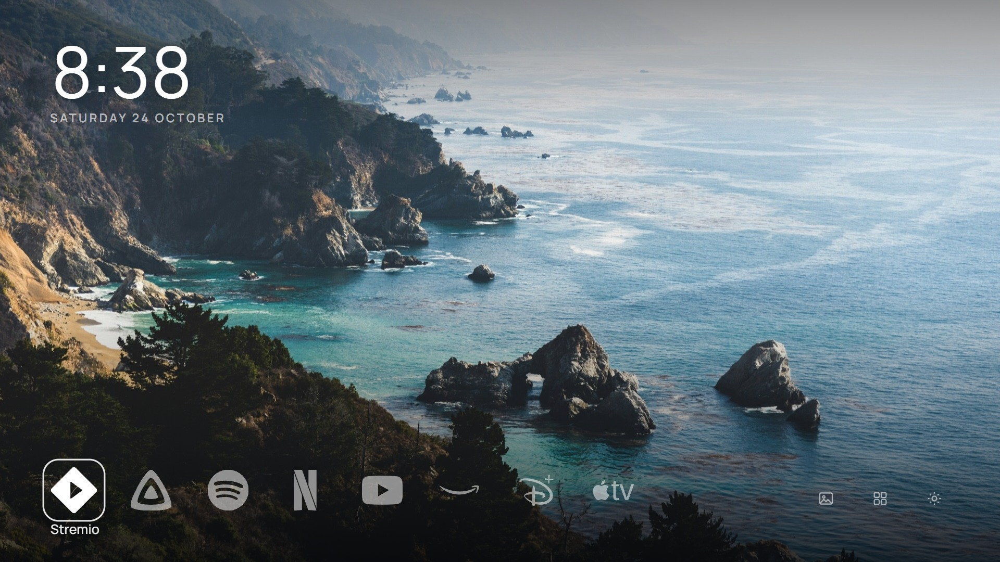

# CleanFrame — gallery home for a Samsung AU8100

A quiet home screen for a 2021 Samsung Crystal UHD: one photograph, the time, and your apps.
Built for personal use on a **UA43AU8100KXXT** running **Tizen 6.0**.



This is a ground-up rewrite of [CleanFrame](https://github.com/nthnclrk/CleanFrame) by Nathan Clark,
which was written for a 2024 The Frame. The photograph catalogue, brand marks, fonts and the Tizen
bridge are kept from that project; the interface is new.

> Unofficial and unaffiliated with Samsung. Use at your own risk.

## Design

- **The photograph is the interface.** No glass panels, no dock container, no card backgrounds. The
  only chrome is a scrim faint enough to preserve the image and strong enough to hold white type.
- **One axis.** Apps sit in a bottom-left rail; the three Home controls continue that same row to the
  right. Arrows move, OK activates, Back does nothing on Home so you cannot fall out of it.
- **Type does the work.** A 136px, weight-200 clock with tabular numerals, an uppercase date with wide
  tracking, and a single 25px app name that appears only under the focused mark.
- **Focus is a hairline.** A 3px white ring, a 1.06 scale and a lift from 52% to full opacity — legible
  from a sofa without a block of colour over the artwork.
- **Motion is transform and opacity only**, 180–220ms. No blur, no backdrop filter, no animated shadow:
  this class of TV hardware has no headroom for them.

## Requirements

- Samsung TV with **Developer Mode** on and this computer's LAN address as **Host PC IP**.
- Tizen Studio CLI (`tz`, `sdb`), usually at `%LOCALAPPDATA%\tizen-studio`.
- A signing profile. The Tizen **public** distributor certificate is accepted by this TV, so no Samsung
  account is needed.

## Install

```powershell
git clone https://github.com/mhzsajan/cleanframe-tv-au8100.git
cd cleanframe-tv-au8100

.\scripts\install.ps1 -TvAddress 192.168.0.7
```

```powershell
.\scripts\build.ps1                                  # package + sign only
.\scripts\install.ps1 -TvAddress <ip> -SkipBuild     # install existing widget
.\scripts\uninstall.ps1 -TvAddress <ip>
```

If PowerShell blocks unsigned scripts: `Set-ExecutionPolicy -Scope Process -ExecutionPolicy Bypass`.

## Using it

**Home → Apps → CleanFrame.**

| Where | Keys |
| --- | --- |
| Home | Left/Right moves along apps then controls, OK opens |
| All apps | Arrows move, OK launches, Back returns |
| Settings | Up/Down, OK changes, Back returns |
| Background | Arrows pick a photograph, OK applies |
| Apps on Home | OK adds or removes a mark (max 9), Back returns |

Preferences live in `localStorage` under `cleanframe.next.v1` — background, 12/24-hour clock and the
Home app list. Nothing is sent anywhere; the app makes no network requests.

## Development

The whole interface is three files, no build step and no framework:

```
app/index.html    markup skeleton
app/ui.css        design tokens and layout
app/ui.js         state, rendering and remote navigation (ES5)
app/device.js     the only file that talks to Tizen
app/assets/       photographs, brand marks, fonts
```

Preview in a browser at TV resolution — the harness stubs `window.tizen` so the app runs without a TV:

```powershell
node tools/shot.mjs dist/shots     # from the workspace root; writes 1920x1080 PNGs
```

Architecture, tokens and extension points are documented in [docs/design.md](docs/design.md).

## Notes from this TV

| Finding | Detail |
| --- | --- |
| Package ID | Must be exactly **10 alphanumeric characters**; a shorter one fails with `install failed[118, -19], reason: Parsing error` |
| Tizen version | `platform_version: 6.0`, so a widget declaring `required_version="6.5"` is rejected |
| Signing | Tizen public distributor works; the Samsung certificate flow is unnecessary |
| Engine | Avoid `inset`, `:has()`, `clamp()` and flex `gap` assumptions — it is older than desktop Chromium |
| Shell access | `sdb shell 0 <command>` works for app operations; `ps`/`ls` are restricted |

## Known limitations

- **No Art Mode.** The Ambient control opens Samsung's Ambient Mode (`org.tizen.ambientapp`), which is
  the equivalent screen on a non-Frame TV.
- **No Home-button takeover.** Deliberate: launch from Apps. Native Home reassignment is an
  undocumented, firmware-specific hack.
- **Developer Mode should stay on.** It was already enabled on this TV.
- **Firmware updates** can change signing or launch behaviour; reinstall after one.

## Licence

Interface, photographs and fonts come from the CleanFrame project and keep their terms — see
[LICENSE](LICENSE) and [THIRD_PARTY_NOTICES.md](THIRD_PARTY_NOTICES.md). Brand marks are from
[Simple Icons](https://simpleicons.org) (CC0) and the CleanFrame icon set. `jellyfin.svg` was added here.
